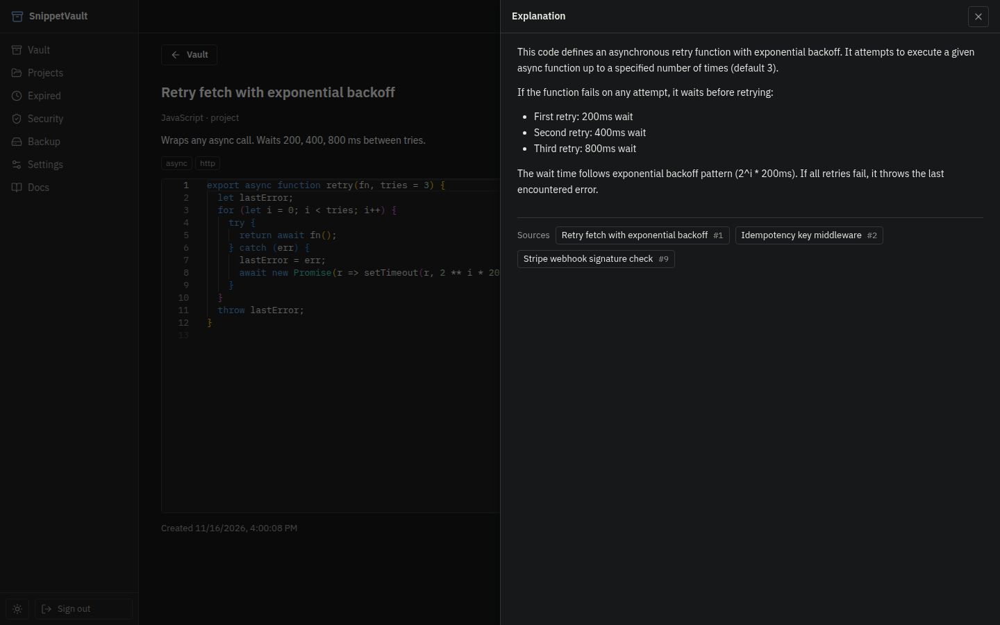
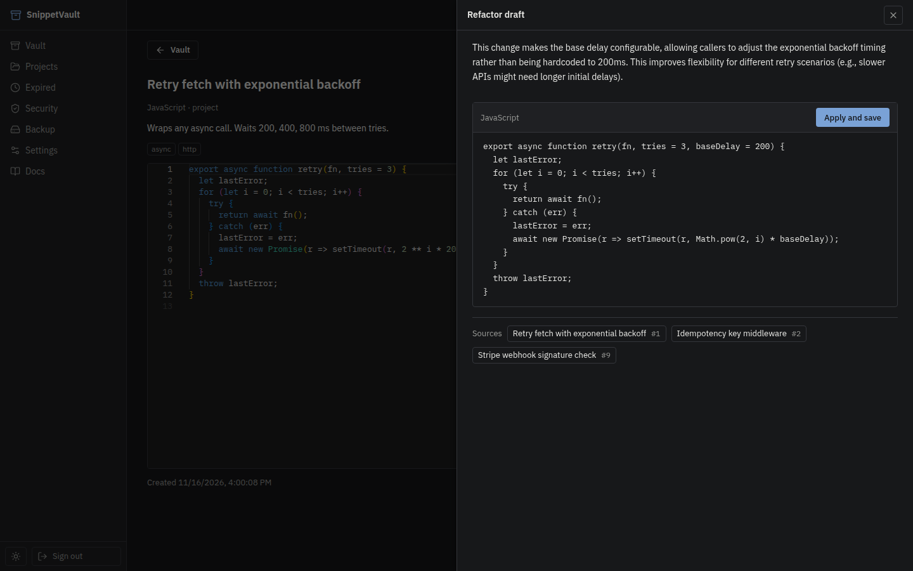
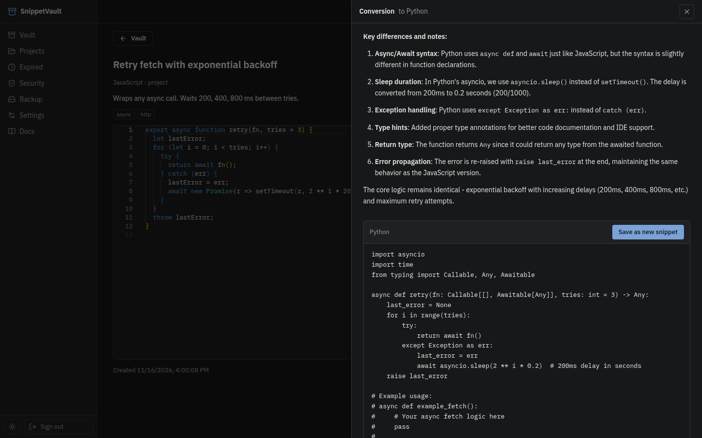
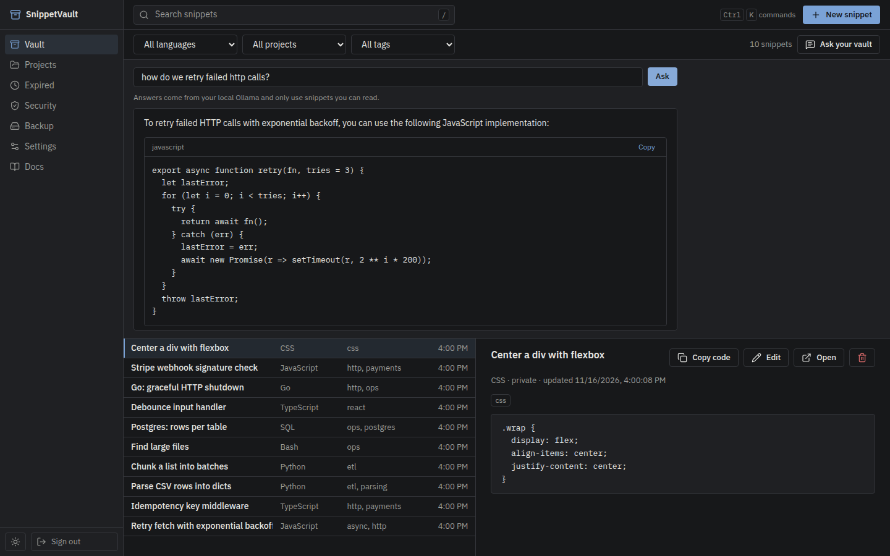
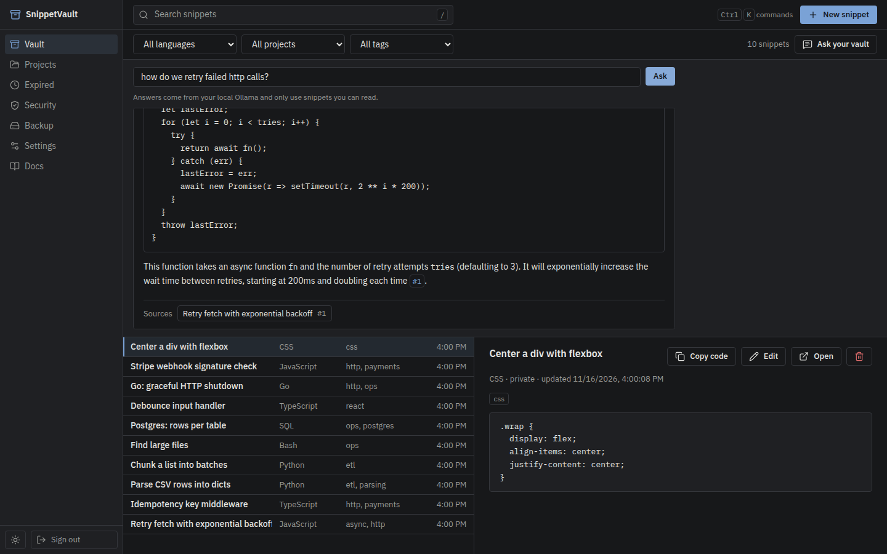
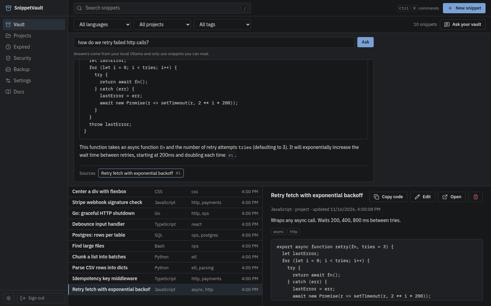
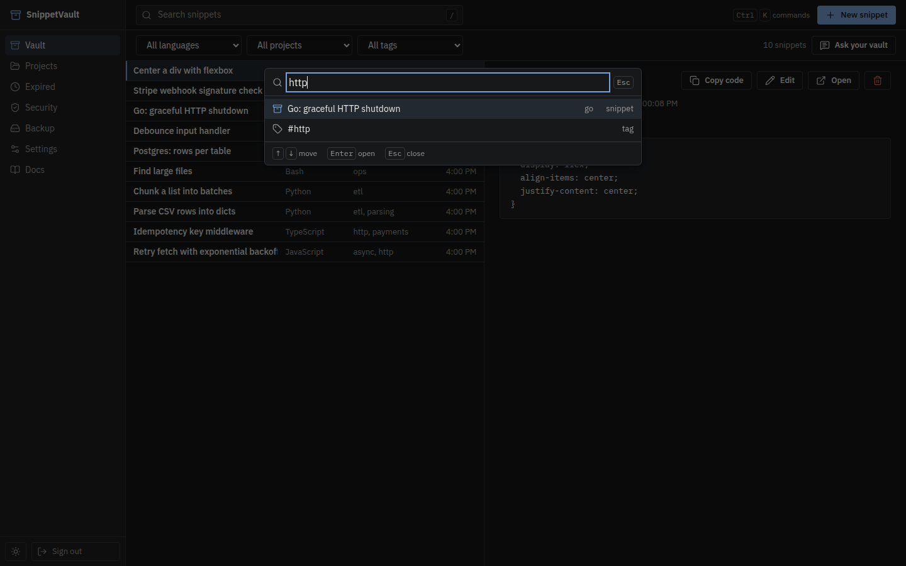

# SnippetVault demo

Self-hosted snippet manager for developer teams. Store, tag, search and share code,
with an assistant that runs on your own Ollama. No cloud account.

Screenshots are the dark theme. Light theme looks the same with light colours.

---

## Login

Email and password. Auth is JWT + bcrypt.

---

## Vault

The main screen works like a mail client for code:

- **List on the left** — one row per snippet: title, language, tags, last change
- **Preview on the right** — the code of the selected row, with Copy code, Edit and Open
- **Filters** — language, project and tag menus above the list
- **Search** — press `/`, it searches title, description and code (SQLite FTS5)
- **Keyboard** — `↑ ↓` move, `Enter` open, `N` new snippet, `Ctrl K` palette

---

## Snippet detail

The code in Monaco, with language, visibility, tags and dates. The assistant is in the
right column: Explain, Summarize, Draft a refactor, Convert to another language.

---

## Assistant — Explain

Answers stream into a side sheet and render as markdown. Sources at the bottom link to
the snippets the answer used. Stop ends the stream, `Esc` closes the sheet.

---

## Assistant — Refactor draft

The explanation comes first, then the suggested code. **Apply and save** writes it to
the snippet. Nothing is saved until you click it.

---

## Assistant — Convert

Pick a target language and click Convert. **Save as new snippet** keeps the result as a
new private snippet. If the code can't be converted (for example browser-only APIs to
Go), the model says why instead of making something up.

---

## Suggest title in the editor

**Suggest title** reads the code and fills title and description. Good titles also help
search.

---

## Ask your vault

Ask a question in plain words. How it works:

1. Hybrid retrieval — keyword match (FTS5) plus vector search (sqlite-vec, local
   embeddings with `@huggingface/transformers`)
2. Only snippets you are allowed to read are used, sensitive ones never
3. Ollama writes the answer, and it must cite at least one snippet or it is not shown
4. `#N` in the answer and the source buttons select that snippet in the preview

New and edited snippets are indexed when they are saved.

---

## Sources in the preview

Clicking a source selects the snippet in the list and shows it in the preview pane.
The answer stays open, you don't lose your place.

---

## Command palette

`Ctrl K` from anywhere. Finds snippets, projects, tags and actions like New snippet or
Settings. Arrows move, `Enter` opens, `Esc` closes.

---

## Projects

Projects group snippets for a team or a repo. Add members by email. Snippets with
**Project** visibility are only visible to members.

---

## Storage modes

| Mode | Stored as | Search | Assistant | Who can read |
|------|-----------|--------|-----------|--------------|
| **Standard** | plain text | full text + semantic | yes | visibility setting |
| **Sensitive** | encrypted in the browser (libsodium) | no | no | you and the people you share with |

---

## Tech stack

| Layer | Technology |
|-------|-----------|
| Runtime | Node.js 24, TypeScript 5.9, npm workspaces |
| Backend | Express 5, better-sqlite3, numbered SQL migrations |
| Frontend | React 19, React Router 7, Vite 7, Monaco Editor |
| Auth | JWT + bcrypt |
| Search | SQLite FTS5 + sqlite-vec |
| Embeddings | @huggingface/transformers (all-MiniLM-L6-v2) |
| Assistant | Ollama on your machine, qwen3-coder:30b by default |
| Encryption | libsodium in the browser, AES-256-GCM for backups |
| Tests | Vitest, Supertest, React Testing Library |
| UI | IBM Plex Sans and Mono, Lucide icons, see [DESIGN.md](DESIGN.md) |
