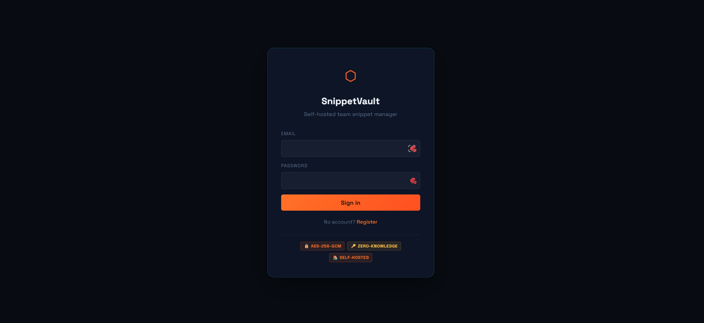
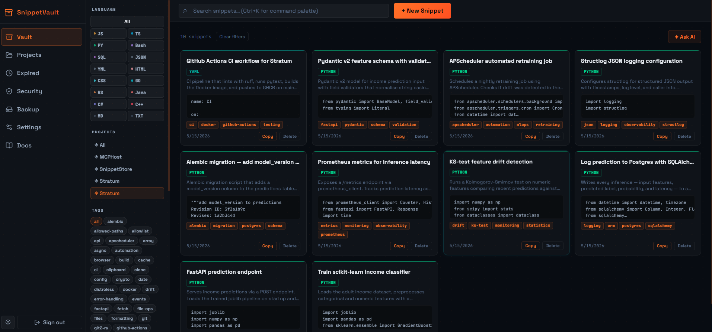
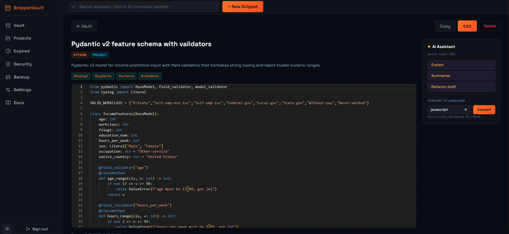
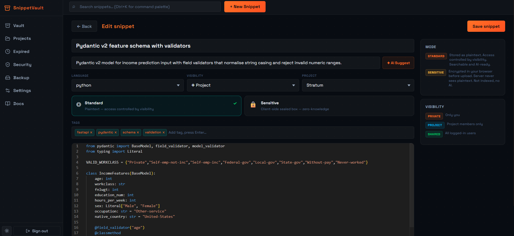
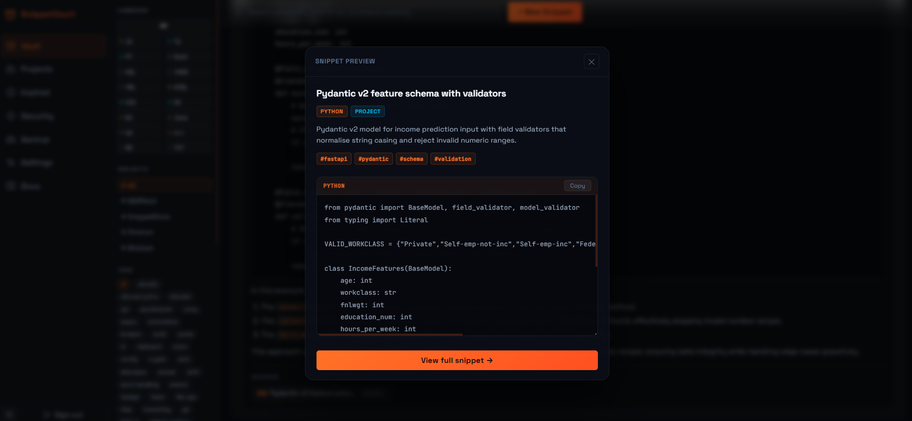
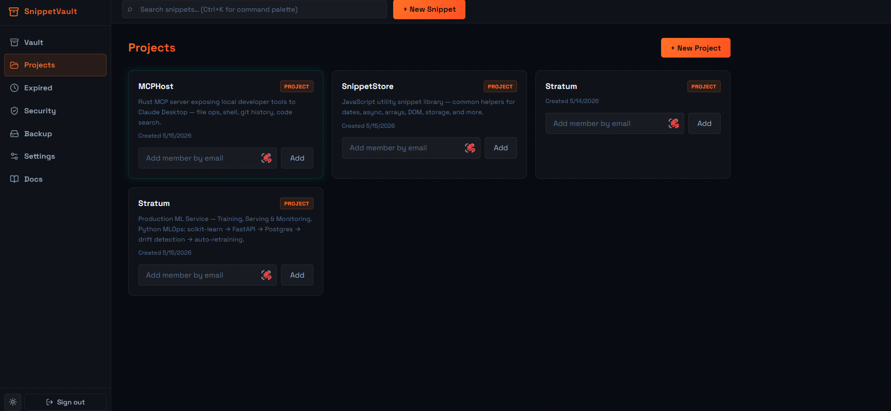

# SnippetVault — Feature Demo

A self-hosted code snippet manager built for developer teams. Stores, tags, searches, and shares code snippets with a local AI assistant powered by Ollama — no cloud account required.

---

## Login

Clean login screen with security badges showing the encryption model upfront. All auth is JWT + bcrypt — no OAuth, no third-party dependencies.

---

## Vault

The main view. Snippets are displayed in a card grid with:

- **Language sidebar** — color-coded chips to filter by language instantly
- **Project switcher** — scope the view to a specific workspace
- **Full-text search** — searches across title, description, and code body (SQLite FTS5)
- **Tag pills** — filter by tags alongside language and project
- **✦ Ask AI** toggle — opens the RAG panel without leaving the page

---

## Snippet detail

Opening a snippet shows the code in Monaco Editor with:

- Language, visibility, and encryption badges in the header
- Tags, description, and creation/update timestamps
- **AI Assistant sidebar** with four actions — Explain, Summarize, Refactor draft, Convert to language
- The local Ollama model name shown beneath the panel heading

---

## AI — Explain

Clicking **Explain** opens a streaming popup. The response is rendered as markdown with:

- Proper headings, bold text, and bullet lists
- **Language-labelled code blocks** — every fenced block shows the language and a **Copy** button
- Citations link back to source snippets
- A Cancel button to stop mid-stream

---

## AI — Refactor draft

**Refactor draft** returns a split view:

- Explanation in rendered markdown at the top
- Extracted code block below with a language label
- **⬇ Apply & Save** — one click applies the refactored code to the snippet and saves it with a toast confirmation

---

## AI — Convert to language

Select any target language from the dropdown and click **Convert**. The popup streams the result and:

- Extracts the converted code block separately from the explanation
- Shows a **＋ Save as new snippet** button — Ollama auto-generates a title for the new language, then creates it as a private snippet
- Refuses clearly with a warning card if the conversion isn't feasible (e.g. browser-only APIs that have no equivalent in the target language)

---

## AI Suggest — in the editor

In the snippet editor, the **✦ AI Suggest** button (next to the description field) reads the code you've written and fills in a proper title and description automatically — improving RAG retrieval quality without any extra effort.

---

## RAG Search Assistant

Ask natural-language questions across your entire snippet library. The RAG pipeline:

1. Runs **hybrid retrieval** — BM25 keyword match (SQLite FTS5) + vector similarity via local embeddings (`@xenova/transformers`)
2. Passes retrieved chunks to Ollama for answer generation
3. **Blocks answers without citation anchors** — every response must cite at least one source snippet
4. Renders the answer as **markdown** with language-labelled code blocks and Copy buttons
5. Inline `↗ #N` chips in the answer text are clickable — they open a snippet preview popup without navigating away
6. **Multi-language awareness** — when retrieved snippets are in different languages, the model labels each code block separately and never mixes them

Snippets are indexed automatically in the background whenever you create or edit one.

---

## Citation popup

Clicking any source chip (inline or at the bottom of a RAG answer) opens a preview popup showing:

- Title, language badge, and visibility
- Tags
- Code preview (first ~600 characters)
- **View full snippet →** button that navigates to the full detail page

The RAG answer stays visible — you never lose context.

---

## Command palette

`Ctrl+K` opens the command palette from anywhere in the app. It searches across:

- Snippet titles and languages
- Project names
- Tags
- Built-in actions: New Snippet, New Project, Settings, Documentation

Arrow keys to navigate, Enter to confirm, Escape to dismiss.

---

## Projects

Organise snippets into project workspaces. Each project card shows the project name, description, and a member add field. Snippets set to **Project** visibility are only visible to members of that project.

---

## Encryption model

SnippetVault uses two snippet modes:

| Mode | Storage | Searchable | AI features | Access control |
|------|---------|-----------|-------------|----------------|
| **Standard** | Plaintext | ✓ Full-text + RAG | ✓ All actions | Visibility setting |
| **Sensitive** | Client-side encrypted (libsodium sealed box) | ✗ | ✗ | Passphrase + recipients |

Standard snippets are stored as plaintext — access is controlled by visibility (Private / Project / Shared). Sensitive snippets are encrypted in the browser before upload; the server stores ciphertext only and cannot read the content under any circumstances.

---

## Tech stack

| Layer | Technology |
|-------|-----------|
| Backend | Node.js 20, Express 4, better-sqlite3 |
| Frontend | React 18, Vite 5, Monaco Editor |
| Auth | JWT + bcrypt |
| Search | SQLite FTS5 (BM25) + local vector embeddings |
| AI | Ollama (local) — qwen3-coder:30b default |
| Embeddings | @xenova/transformers (all-MiniLM-L6-v2) |
| Encryption | libsodium (client-side), AES-256-GCM (backup) |
| Icons | Lucide React |
| Font | Space Grotesk + JetBrains Mono |
