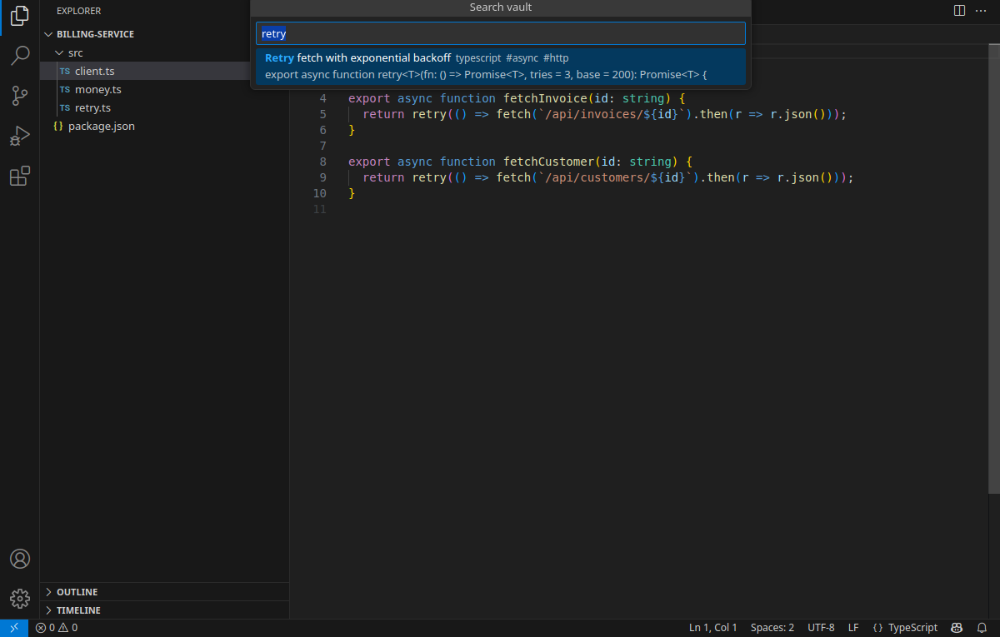
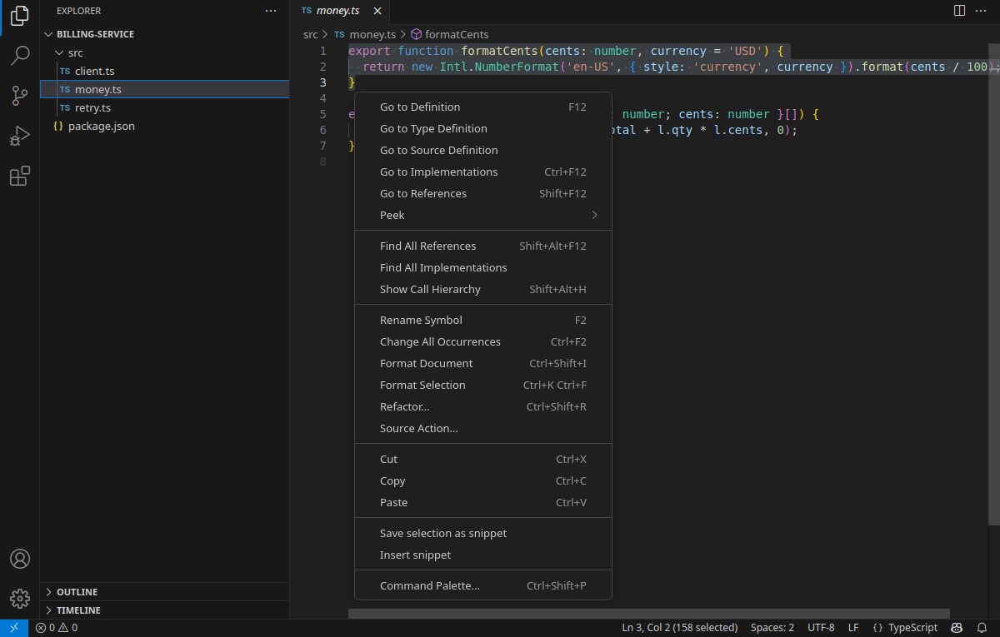
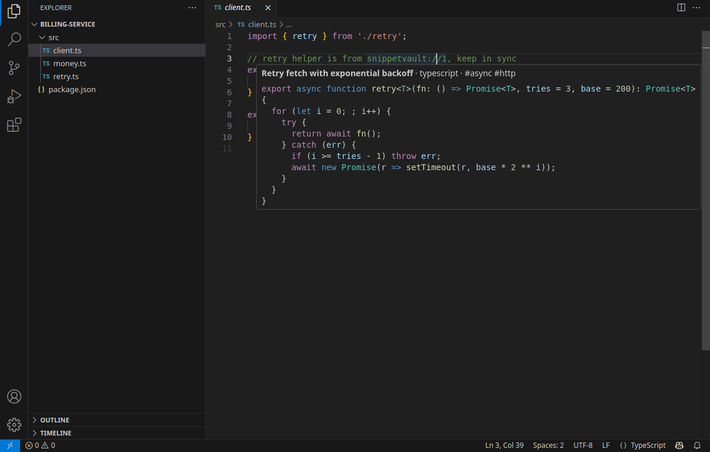

# VS Code extension

Search, insert and save snippets from the editor.



## Install

The extension is not on the Marketplace. Take `snippetvault-3.2.0.vsix` from the CI
artifacts, or build it:

```bash
npm run build
npm run package -w snippetvault
code --install-extension packages/vscode/snippetvault-3.2.0.vsix
```

Works with VS Code 1.100 and newer.

## Connect

1. Web app, **Access tokens**: make a token with `read`, and `write` if you want
   to save from the editor
2. Command palette, **SnippetVault: Set access token**, paste it
3. Server not on `http://localhost:3001`? Set `snippetvault.serverUrl`

The token is kept in VS Code secret storage, never in `settings.json`.

## Commands

| Command | What it does |
|---|---|
| SnippetVault: Search vault | search as you type, Enter opens the snippet in a new tab |
| SnippetVault: Insert snippet | puts the snippet at the cursor, lines keep your indent |
| SnippetVault: Save selection as snippet | asks title and tags, saves the selection or the whole file |
| SnippetVault: Sign out | removes the token |

Insert and Save are also in the editor right click menu.



## Links in code

Write `snippetvault://12` in a comment and hover it to see that snippet.



## Keybindings

Commands take arguments, so a key can skip the questions:

```json
[
  { "key": "ctrl+alt+v", "command": "snippetvault.search", "args": "docker" },
  { "key": "ctrl+alt+s", "command": "snippetvault.saveSelection", "args": { "title": "Scratch", "tags": ["inbox"] } }
]
```

## Good to know

- Sensitive snippets never show up in the editor, they open only in the web app.
- Language maps both ways, for example `bash` in the vault is `shellscript` in
  VS Code, and `typescriptreact` saves as `typescript`.
